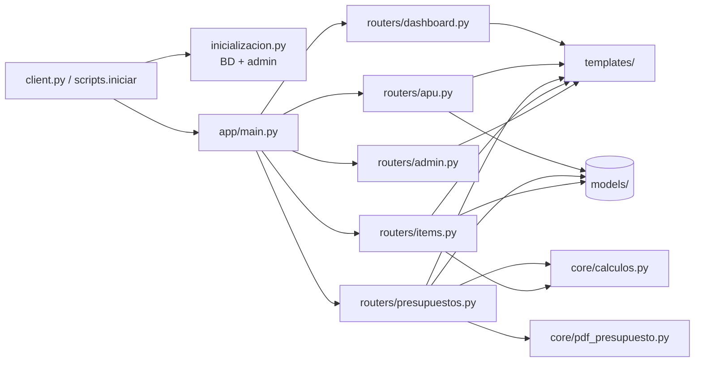
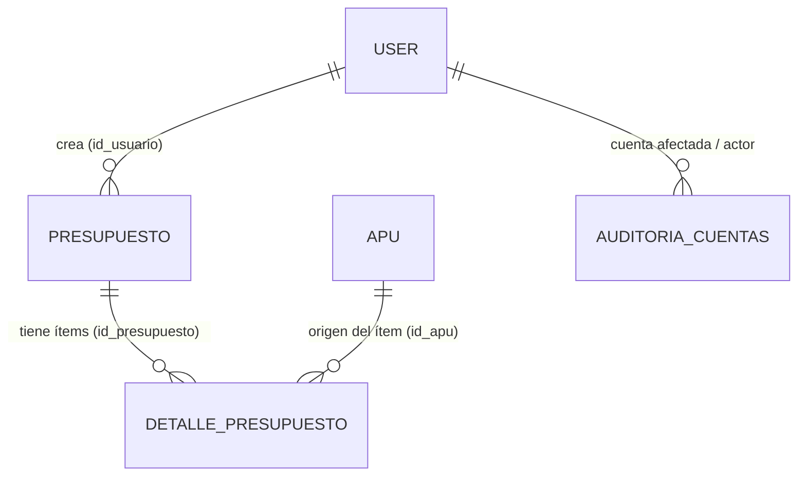

# Arquitectura: mapa de archivos y conexiones

Esta guía explica **dónde está cada cosa**, **qué archivos trabajan juntos** y **qué pantalla ve el usuario** gracias a ellos.

- Instalar, arrancar y ver datos de prueba: [`README.md`](../README.md).
- Protección de cada ruta: [`docs/rutas.md`](rutas.md).

> El proyecto sigue en desarrollo. Si cambias una ruta, una plantilla o un modelo, revisa la [lista de mantenimiento](#9-cómo-mantener-esta-guía) al final.

---

## Índice
1. [Las 5 capas](#1-las-5-capas)
2. [Recorrido de una petición (ejemplo completo)](#2-recorrido-de-una-petición-ejemplo-completo)
3. [Modelos y cómo se relacionan](#3-modelos-y-cómo-se-relacionan)
4. [Módulos funcionales](#4-módulos-funcionales)
5. [Mapa pantalla → URL → código](#5-mapa-pantalla--url--código)
6. [Archivos transversales (los usan todos)](#6-archivos-transversales-los-usan-todos)
7. [Plantillas: páginas completas y fragmentos HTMX](#7-plantillas-páginas-completas-y-fragmentos-htmx)
8. [Estado del desarrollo y pendientes](#8-estado-del-desarrollo-y-pendientes)
9. [Cómo mantener esta guía](#9-cómo-mantener-esta-guía)

---

## 1. Las 5 capas

Toda funcionalidad pasa por las mismas capas. Si conoces la capa, sabes en qué carpeta buscar.

| # | Capa | Carpeta | Qué hace |
|---|---|---|---|
| 1 | **Arranque** | `client.py`, `scripts/iniciar.py`, `app/core/inicializacion.py` | Prepara la base de datos y el usuario admin, levanta el servidor y abre la ventana |
| 2 | **Aplicación** | `app/main.py` | Crea FastAPI, registra los middlewares y los routers. Contiene el login y el logout |
| 3 | **Rutas (routers)** | `app/core/routers/` | Reciben la petición, validan permisos y datos, y eligen qué plantilla devolver |
| 4 | **Lógica y datos** | `app/models/`, `app/core/*.py` | Tablas (modelos), cálculos, validaciones, permisos, PDF |
| 5 | **Vista** | `app/templates/`, `app/static/` | El HTML que ve el usuario (Jinja2 + HTMX + Alpine + Tailwind) |



---

## 2. Recorrido de una petición (ejemplo completo)

**Caso: el usuario agrega un ítem a un presupuesto.** Sirve como modelo mental para cualquier otra acción.

| Paso | Qué ocurre | Archivo |
|---|---|---|
| 1 | En **Presupuestos**, el usuario pulsa el ícono **+** de una fila | `templates/partials/presupuesto/tabla.html` |
| 2 | Se abre `GET /presupuestos/{id}/items/nuevo` | `core/routers/items.py` |
| 3 | `requireRoles(...)` comprueba la sesión y el rol (BUDGETS, BOTH o ADMIN) | `core/dependencies.py` + `core/permisos.py` |
| 4 | Se muestra la página "Agregar ítem" con los "APU asignados" | `templates/item_nuevo.html` |
| 5 | El usuario escribe en el buscador → HTMX llama a `GET /api/apu/buscar` | `routers/items.py` → `partials/apu/buscar_resultados.html` |
| 6 | Al elegir un APU → `GET /api/apu/{id}/autocompletar` rellena unidad y costos | `routers/items.py` → `partials/apu/autocompletar_campos.html` |
| 7 | Envía el formulario → `POST /presupuestos/{id}/items` | `routers/items.py` (`crearItem`) |
| 8 | Se crea un `DetallePresupuesto` con una **copia** de los costos del APU | `models/detalle_presupuesto.py` |
| 9 | `calcularSubtotales()` y `recalcularPresupuesto()` actualizan los totales | `core/calculos.py` |
| 10 | `flash(...)` deja el aviso "Ítem agregado correctamente." | `core/flash.py` → `partials/flash.html` |
| 11 | Redirige otra vez a la página del paso 4, ya con el ítem nuevo en la tabla | `routers/items.py` |

---

## 3. Modelos y cómo se relacionan

Los modelos están en `app/models/`. Cada uno es una tabla de SQLite. Las migraciones de Alembic en `alembic/versions/` definen cómo se crean y cambian esas tablas.



| Modelo (archivo) | Tabla | Qué representa | Conectado con |
|---|---|---|---|
| `User` (`user.py`) | `user` | Cuentas, rol, bloqueo por intentos fallidos | `Presupuesto` (quién lo creó), `AuditoriaCuenta` |
| `APU` (`apu.py`) | `apu` | Catálogo de precios unitarios: costo **cotizado** (`unit_cost`) y **real** (`real_unit_cost`) | `DetallePresupuesto` |
| `Presupuesto` (`presupuesto.py`) | `presupuesto` | Cabecera: cliente, fechas, estado, porcentajes y totales | `User`, `DetallePresupuesto` |
| `DetallePresupuesto` (`detalle_presupuesto.py`) | `detalle_presupuesto` | Cada línea (ítem) del presupuesto | `Presupuesto`, `APU` |
| `AuditoriaCuenta` (`auditoria.py`) | `auditoria_cuentas` | Registro de bloqueos, reactivaciones y desactivaciones | `User` |

### `presupuesto` y `detalle_presupuesto`: por qué están conectados

- **Relación:** un `Presupuesto` tiene muchos `DetallePresupuesto` (uno por ítem). La clave foránea es `detalle_presupuesto.id_presupuesto`. La relación usa `cascade="all, delete-orphan"`: si se borra el presupuesto, también se borran sus ítems.
- **Qué hacen juntos:** el detalle guarda las líneas (cantidad × costo) y el presupuesto guarda la **suma** de esas líneas y lo que se calcula a partir de ella. `core/calculos.py::recalcularPresupuesto` lee los detalles y escribe en el presupuesto `total_cotizado`, `total_real`, gastos generales, utilidad, IVA y total.
- **Por qué el detalle copia los costos:** `estimated_unit_cost` y `real_unit_cost` son una **foto** del APU en el momento de agregarlo. Si después cambia el precio del APU en el catálogo, los presupuestos que ya existen no cambian. `id_apu` se guarda solo para saber de qué APU salió cada línea.
- **Funcionalidad a la que pertenecen:** armar presupuestos y cotizarlos.
- **Dónde lo ve el usuario:**
  - Ítems: **Presupuestos → ícono +** (`/presupuestos/{id}/items/nuevo`), tabla "APU asignados".
  - Totales: columna de monto en el listado de **Presupuestos**, pantalla **%** (`/presupuestos/{id}/porcentajes`) y el **PDF** exportado.

### `apu` y `detalle_presupuesto`
- El APU es el **catálogo** y el detalle es su **uso** dentro de un presupuesto.
- `core/calculos.py::totalesPorCategoria` une las dos tablas para agrupar los ítems por `APU.category`. El resultado aparece en la pantalla **%**.
- Un APU inactivo (`is_active = False`) no se puede agregar a un presupuesto nuevo: `/api/apu/{id}/autocompletar` devuelve 404 y `crearItem` lo rechaza.

### `user`, `presupuesto` y `auditoria_cuentas`
- `presupuesto.id_usuario` indica quién lo creó. No limita quién puede editarlo: cualquier rol de edición edita todos los presupuestos.
- `core/bloqueo.py` modifica `User` (intentos, bloqueo) y escribe en `AuditoriaCuenta` en la misma operación.

### Modelos de validación (no son tablas)
En los mismos archivos hay clases sin `table=True`: `APUValidacion`, `PresupuestoValidacion` y `PorcentajesValidacion`. Validan los formularios antes de guardar y usan las reglas de `core/validaciones.py`.

---

## 4. Módulos funcionales

Formato de cada módulo: **qué hace · archivos conectados · dónde lo ve el usuario · quién puede entrar**.

### 4.1 Arranque y app de escritorio
- **Qué hace:** crea o migra la base de datos, asegura que haya un ADMIN, elige el puerto, levanta uvicorn y abre la ventana de pywebview.
- **Archivos:**
  - `client.py`: lanzador de la ventana. Su clase `ApiEscritorio.guardarPdf` muestra el diálogo de guardado nativo del PDF.
  - `scripts/iniciar.py`: el mismo arranque, pero para desarrollo (crea los 4 usuarios de prueba y acepta `--demo`).
  - `app/core/inicializacion.py`: lógica compartida por los dos anteriores (`prepararBaseDatos`, `asegurarAdmin`, `BaseDatosFaltante`). Usa Alembic (`alembic/`, `alembic.ini`).
  - `app/core/config.py` + `app/core/paths.py`: ruta de la base de datos, `SECRET_KEY`, datos de la empresa.
  - `app/core/db.py`: motor SQLite (modo WAL) y `getSession`.
  - `build.spec`: empaqueta todo lo anterior con PyInstaller.
- **Usuario:** ventana de escritorio. Si la base no está, aparece un cuadro de diálogo.

### 4.2 Login, sesión y seguridad
- **Qué hace:** inicia y cierra sesión, cierra la sesión tras 30 min de inactividad y bloquea la cuenta después de 5 intentos fallidos.
- **Archivos:**
  - `app/main.py`: rutas `/login`, `/logout` y `/api/sesion/actividad`.
  - `app/core/security.py`: hash y verificación de contraseñas (bcrypt).
  - `app/core/dependencies.py`: `CurrentUser`, `OptionalUser`, `requireRoles`, control de inactividad.
  - `app/core/permisos.py`: qué roles entran a cada módulo (`ROLES_APU`, `ROLES_PRESUPUESTOS_*`). La función `puede()` se usa en las plantillas.
  - `app/core/bloqueo.py`: intentos fallidos, bloqueo temporal y auditoría (`models/auditoria.py`).
  - `app/core/handlers.py`: convierte "sin sesión" o "sin permiso" en una redirección, la página 403 o un JSON, según el tipo de petición.
  - Plantillas: `auth/login.html`, `errors/403.html`.
- **Usuario:** pantalla de login y avisos como *"Tu sesión se ha cerrado por inactividad."*.
- **Roles:** público (login).

### 4.3 Dashboard
- **Qué hace:** muestra un resumen de los módulos a los que tiene acceso el usuario.
- **Archivos:** `routers/dashboard.py` (`_resumenPresupuestos`, `_resumenApu`, `_resumenUsuarios`) → `templates/dashboard.html` (usa `stat_card` de `partials/ui.html`). Lee `Presupuesto`, `APU`, `User` y `AuditoriaCuenta`.
- **Usuario:** `/dashboard`, la primera pantalla después del login. Cada bloque aparece solo si `puede(usuario, ...)`.
- **Roles:** todos los autenticados.

### 4.4 Catálogo de APU
- **Qué hace:** crea, edita, activa o desactiva APU, con filtros y paginación.
- **Archivos:**
  - `routers/apu.py` → `models/apu.py` (`APU`, `APUValidacion`) → `core/validaciones.py`.
  - Página completa: `templates/apu.html` (incluye `partials/apu/tabla.html`).
  - Formulario: `partials/apu/formulario.html` (con HTMX) o `apu/formulario.html` (sin HTMX).
- **Usuario:** menú lateral **APU** → `/apu`. El botón "Nuevo" abre el formulario y el interruptor de cada fila activa o desactiva el APU.
- **Roles:** MATERIALS, BOTH, ADMIN.

### 4.5 Presupuestos (cabecera)
- **Qué hace:** lista, crea y edita presupuestos y cambia su estado (DRAFT, ACTIVE o CLOSE).
- **Archivos:**
  - `routers/presupuestos.py` → `models/presupuesto.py` (`Presupuesto`, `PresupuestoValidacion`, `StatusPresupuestos`).
  - Página: `templates/presupuesto.html` (incluye `partials/presupuesto/resumen.html` y `partials/presupuesto/tabla.html`).
  - Formulario: `partials/presupuesto/formulario.html`.
- **Usuario:** menú lateral **Presupuestos** → `/presupuestos`. Cada fila tiene los botones editar ✎, **%** y **+**.
- **Roles:** ver: BUDGETS, BOTH, ADMIN, VIEWER · editar: BUDGETS, BOTH, ADMIN.

### 4.6 Ítems del presupuesto (`detalle_presupuesto`)
- **Qué hace:** agrega y edita las líneas de un presupuesto a partir del catálogo de APU.
- **Archivos:** `routers/items.py` → `models/detalle_presupuesto.py` + `models/apu.py` + `models/presupuesto.py` → `core/calculos.py` → `templates/item_nuevo.html`, `partials/apu/buscar_resultados.html`, `partials/apu/autocompletar_campos.html`.
- **Usuario:** ícono **+** del listado de Presupuestos → `/presupuestos/{id}/items/nuevo`.
- **Roles:** BUDGETS, BOTH, ADMIN.
- Ver el [recorrido completo](#2-recorrido-de-una-petición-ejemplo-completo) y la [relación con presupuesto](#presupuesto-y-detalle_presupuesto-por-qué-están-conectados).

### 4.7 Porcentajes y totales
- **Qué hace:** define el % de gastos generales, utilidad e IVA, y los montos fijos de costo directo y costo neto. Muestra los totales por categoría.
- **Archivos:** `routers/presupuestos.py` (`/presupuestos/{id}/porcentajes`) → `PorcentajesValidacion` → `core/calculos.py` (`calcularMontos`, `recalcularPresupuesto`, `totalesPorCategoria`) → `presupuesto_porcentajes.html` / `partials/presupuesto/porcentajes.html`.
- **Usuario:** botón **%** del listado de Presupuestos.
- **Roles:** ver: incluye VIEWER · guardar: BUDGETS, BOTH, ADMIN.

### 4.8 Exportar PDF
- **Qué hace:** genera la cotización en PDF con ReportLab.
- **Archivos:** `routers/presupuestos.py` (`/presupuestos/exportar` = selector, `/presupuestos/{id}/pdf` = archivo) → `core/pdf_presupuesto.py` (lee `Presupuesto`, `DetallePresupuesto`, `APU` y `DATOS_EMPRESA` de `config.py`, y usa `static/img/logo_sefel.png`) → `partials/presupuesto/exportar.html`. En la app de escritorio, `client.py::ApiEscritorio.guardarPdf` guarda el archivo.
- **Usuario:** botón **Exportar** en Presupuestos.
- **Roles:** incluye VIEWER.

### 4.9 Usuarios (administración)
- **Qué hace:** crea y edita cuentas, cambia roles y activa o reactiva cuentas.
- **Archivos:** `routers/admin.py` → `models/user.py` → `core/security.py` (hash) + `core/bloqueo.py` (`desactivarCuenta`, `reactivarCuenta`) → `templates/admin-panel/list.html`.
- **Usuario:** menú lateral **Usuarios** → `/admin/users`.
- **Roles:** ADMIN.

### 4.10 Avisos y errores
- **Avisos:** `core/flash.py` (`flash()` guarda el mensaje y el middleware `NotificacionesHtmx` lo envía en la cabecera `HX-Trigger`) → `partials/flash.html`. Así se muestran las notificaciones flotantes del tipo "APU creado correctamente.".
- **Errores de base de datos:** `core/errores_bd.py` (explica cada error) → `core/handlers.py` → `errors/base_datos.html`.
- **Registro (log):** `core/logging.py`. Escribe en `logs/sefel.log` dentro de la carpeta de datos del usuario.

---

## 5. Mapa pantalla → URL → código

| Lo que ve el usuario | URL | Router (función) | Plantilla |
|---|---|---|---|
| Login | `/login` | `main.py` (`mostrarLogin` / `procesarLogin`) | `auth/login.html` |
| Dashboard | `/dashboard` | `dashboard.py` | `dashboard.html` |
| Listado de APU | `/apu` | `apu.py` | `apu.html` + `partials/apu/tabla.html` |
| Nuevo / editar APU | `/apu/nuevo`, `/apu/{id}/editar` | `apu.py` | `partials/apu/formulario.html` (o `apu/formulario.html`) |
| Listado de presupuestos | `/presupuestos` | `presupuestos.py` | `presupuesto.html` + `partials/presupuesto/tabla.html` + `resumen.html` |
| Nuevo / editar presupuesto | `/presupuestos/nuevo`, `/presupuestos/{id}/editar` | `presupuestos.py` | `partials/presupuesto/formulario.html` |
| Porcentajes (botón %) | `/presupuestos/{id}/porcentajes` | `presupuestos.py` | `presupuesto_porcentajes.html` / `partials/presupuesto/porcentajes.html` |
| Exportar (selector) | `/presupuestos/exportar` | `presupuestos.py` | `partials/presupuesto/exportar.html` |
| PDF | `/presupuestos/{id}/pdf` | `presupuestos.py` → `pdf_presupuesto.py` | (archivo PDF) |
| Agregar / editar ítems (botón +) | `/presupuestos/{id}/items/nuevo` | `items.py` | `item_nuevo.html` |
| Buscador de APU (dentro de ítems) | `/api/apu/buscar` | `items.py` | `partials/apu/buscar_resultados.html` |
| Usuarios | `/admin/users` | `admin.py` | `admin-panel/list.html` |
| Sin permiso | (cualquiera) | `handlers.py` | `errors/403.html` |
| Error de base de datos | (cualquiera) | `handlers.py` | `errors/base_datos.html` |

---

## 6. Archivos transversales (los usan todos)

| Archivo | Para qué sirve | Quién lo usa |
|---|---|---|
| `app/templates.py` | Configura Jinja2 y expone a las plantillas `puede`, `REGLAS_HTML`, `get_flashed_messages` y los filtros `clp`, `fecha`, `rol_label` e `iniciales` | Todos los routers |
| `core/db.py` | `getSession` (una sesión de BD por petición) | Todos los routers, `inicializacion.py` |
| `core/dependencies.py` | Usuario actual y verificación de roles | Todos los routers |
| `core/permisos.py` | Fuente única de "qué rol entra a qué" | Routers y plantillas (`sidebar.html`) |
| `core/validaciones.py` | Reglas de texto y fechas. `REGLAS_HTML` aplica los mismos patrones en los formularios | Modelos de validación y plantillas |
| `core/formato.py` | Formato de pesos chilenos (CLP), fechas y etiquetas de rol | `templates.py` |
| `templates/base.html` | Esqueleto de todas las páginas (incluye navbar, sidebar y flash) | Todas las páginas |
| `partials/ui.html` | Macros reutilizables: `icono`, `encabezado`, `stat_card`, `paginacion`, `interruptor` | Listados y dashboard |
| `static/js/htmx.min.js`, `alpine.min.js` | Interactividad sin recargar la página | `base.html` |
| `static/css/input.css` → `output.css` | Estilos de Tailwind (se compilan) | `base.html` |

---

## 7. Plantillas: páginas completas y fragmentos HTMX

La mayoría de las rutas responden de dos formas:

- **Petición normal** (escribir la URL, recargar): devuelven una **página completa** que hereda de `base.html`.
- **Petición HTMX** (cabecera `HX-Request: true`, al pulsar un botón): devuelven solo un **fragmento** de `partials/` que reemplaza una parte de la página.

El router decide entre las dos así:

```python
name = "partials/apu/tabla.html" if es_htmx else "apu.html"
```

**Regla práctica:** si existe `partials/X/algo.html`, normalmente también existe una página que lo envuelve. Por ejemplo, `apu.html` incluye `partials/apu/tabla.html`.

---

## 8. Estado del desarrollo y pendientes

Encontrado al revisar el código el 26/11/2026:

| Tema | Detalle | Archivo |
|---|---|---|
| ⚠️ Plantilla que falta | `_renderFormulario` usa `presupuesto/formulario.html` cuando la petición **no** es HTMX, pero ese archivo no existe. Abrir `/presupuestos/nuevo` o `/presupuestos/{id}/editar` recargando la página o en otra pestaña da error 500. Los tests solo prueban la versión HTMX. Solución sugerida: crear `templates/presupuesto/formulario.html` igual a `apu/formulario.html` (que extienda `base.html` e incluya el partial) | `routers/presupuestos.py:252` |
| Plantilla sin uso aparente | Ningún router renderiza `admin-panel/form.html`. El formulario de usuarios vive en `list.html` (`?nuevo=1`) | `templates/admin-panel/form.html` |
| Rutas de prueba | `/protegido`, `/prueba/solo-admin`, `/prueba/presupuestos` y `/api/saludo` se eliminarán más adelante | `app/main.py` |
| Redirección después del login | Siempre va a `/dashboard`. Hay un comentario para usar `next_url` | `app/main.py` |
| APU repetido en un presupuesto | La restricción única está comentada: hoy un APU puede repetirse en el mismo presupuesto | `models/detalle_presupuesto.py` |
| Codificación de `requirements.txt` | El archivo está en UTF-16, no en UTF-8. `pip` lo lee, pero algunas herramientas no | `requirements.txt` |

---

## 9. Cómo mantener esta guía

Al agregar o cambiar algo, sigue esta lista:

1. **Ruta nueva:** agrégala a la tabla de [la sección 5](#5-mapa-pantalla--url--código) y al inventario de [`rutas.md`](rutas.md). Comprueba las rutas con `python -m scripts.listar_rutas`.
2. **Modelo nuevo o con relaciones nuevas:** actualiza el [diagrama y la tabla de la sección 3](#3-modelos-y-cómo-se-relacionan). Además, impórtalo en `app/models/__init__.py` y `alembic/env.py`, y genera la migración.
3. **Módulo nuevo:** agrega una subsección en la [sección 4](#4-módulos-funcionales) con el mismo formato: qué hace, archivos, dónde lo ve el usuario y roles.
4. **Pendiente resuelto:** quítalo de la [sección 8](#8-estado-del-desarrollo-y-pendientes).
